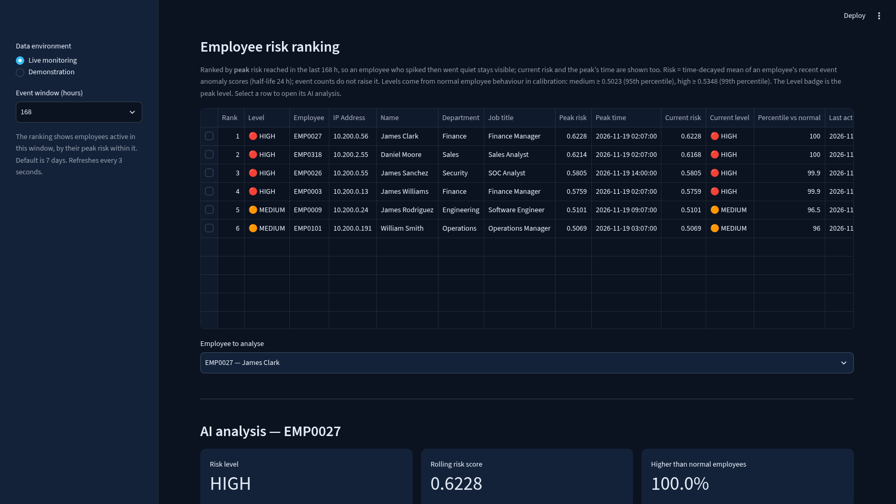
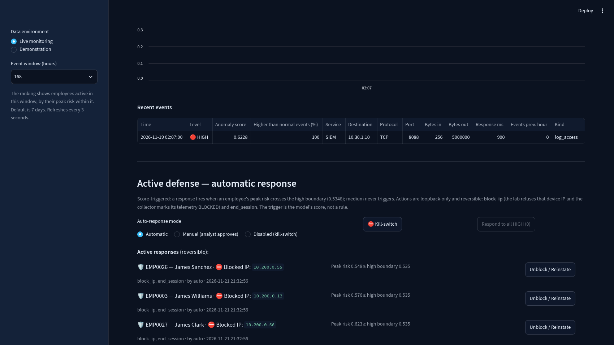

# Development of an Anomaly-Driven Active Defense Platform Against Unauthorized Access and Credential Attacks

A local platform for detecting anomalous activity inside an organisation's network and responding to it. A
background collector reads network and host telemetry, attributes each event to an employee through the device
directory, and scores it with an Isolation Forest trained on normal behaviour only. Event scores are aggregated into
a per-employee risk, presented on a dashboard with a plain-language explanation, and, when the risk reaches the high
level, used to trigger a reversible response. The application studied here is insider-threat detection: six insider
attack categories are evaluated on a synthetic organisation of 1,000 employees.

The full academic report is in [docs/REPORT.md](docs/REPORT.md).



## Contents

1. [Problem Statement](#problem-statement)
2. [Features](#features)
3. [System Architecture](#system-architecture)
4. [Tools and Technologies](#tools-and-technologies)
5. [The AI Model](#the-ai-model)
6. [Dataset](#dataset)
7. [Results](#results)
8. [Project Structure](#project-structure)
9. [Installation](#installation)
10. [Running the Platform](#running-the-platform)
11. [Running the Attack Scenarios](#running-the-attack-scenarios)
12. [Active Response](#active-response)
13. [Testing](#testing)
14. [Limitations and Future Work](#limitations-and-future-work)

## Problem Statement

Activity by insiders uses valid credentials, known devices and permitted services, so it does not appear as a
malformed request or an unknown source. Signature-based monitoring looks for patterns known in advance and does not
describe how far an action departs from what a given employee normally does. Security analysts also need the
result at the level of a person, not of a single log line, together with the reason for it and a controlled way to
respond.

The platform addresses this by:

* learning normal behaviour, both organisation-wide and per employee, from unlabelled normal activity;
* measuring every new event as a deviation from that normal behaviour;
* aggregating event deviations into an employee risk whose medium and high levels are percentiles of normal risk;
* explaining each employee's risk in terms of their own baseline; and
* applying a bounded, reversible and audited response when the risk reaches the high level.

## Features

* **Per-event anomaly score.** Every collected event receives an Isolation Forest score and a level (low, medium,
  high) derived from the score distribution of held-out normal events.
* **Per-employee risk score.** Event scores are combined into a time-decayed mean (half-life 24 h). The number of
  events does not raise the risk.
* **Employee ranking.** Employees active in the selected window are ranked by the peak risk they reached in it, with
  current risk, peak time, percentile against normal employees and event counts shown alongside.
* **Explanation.** For each employee, the dashboard identifies the event weighing most on the risk and lists the
  largest deviations from that employee's own baseline (data sent and received, response time, activity in the
  previous hour, time of day, rarity of the service), each expressed in standard deviations or shares of baseline
  activity.
* **Device IP display.** The ranking shows the source IP of the device that produced the risk-raising event; the
  explanation shows the same address with the device hostname and type. The IP is used for display and response
  only and is not a model input.
* **Automatic response.** When an employee's peak risk crosses the high level, the platform can block the device IP
  and end the employee's lab session, automatically or after analyst approval. Every action is reversible from the
  dashboard and recorded in an audit log.
* **Demonstration mode.** A 48-hour unlabelled replay of synthetic organisation activity, isolated from live data.

## System Architecture

The platform runs as three local services (collector, loopback lab, dashboard) sharing one SQLite database. Data
passes through five stages.

```
  Telemetry sources: JSONL inbox, HTTP access log, systemd Journal, watched files
        |
        v
  [1] Collection          monitor/worker.py, collectors.py, journal.py, adapters.py
        |                 incremental reads, durable cursors, one writer;
        |                 source_ip -> device -> employee (models/ai_engine/directory.json)
        v
  [2] Scoring             monitor/core.py -> monitor/brain/
        |                 18 features (temporal, volume, personal deviation);
        |                 Isolation Forest score and event level per event
        v
  [3] Risk aggregation    monitor/brain/risk.py, monitor/views.py
        |                 time-decayed mean of event scores per employee;
        |                 peak and current risk, employee level (P95 / P99)
        v
  [4] Presentation        app.py (Streamlit), monitor/brain/explain.py
        |                 employee ranking, device IP, explanation, event history
        v
  [5] Response            monitor/response.py -> runtime/lab/enforcement.json
                          block_ip and end_session when peak risk >= high level;
                          honoured by the lab target and the collector; audited and reversible
```

| Stage | Input | Output |
| --- | --- | --- |
| Collection | Raw telemetry lines and file changes | Stored events attributed to an employee and device, or marked unattributed |
| Scoring | One event and the employee's baseline | Anomaly score and event level |
| Risk aggregation | The employee's scored events | Current risk, peak risk in the window, employee level |
| Presentation | Ranked employees and their events | Dashboard ranking, explanation, charts |
| Response | Employees whose peak risk is at the high level | Blocked IP, ended session, audit record |

## Tools and Technologies

1. **Isolation Forest** (scikit-learn 1.9.1): unsupervised anomaly detection model.
2. **Python 3.14** (3.14.10): implementation language for the collector, model, dashboard and lab.
3. **pandas and NumPy** (pandas 2.3.3, NumPy 2.5.5): feature derivation, baselines and evaluation.
4. **Streamlit** (1.67.0): dashboard.
5. **SQLite** (3.53, WAL mode): event, risk, response and audit storage.
6. **Kali Linux** (2026.3): host operating system; the services run as systemd user units.
7. **pytest** (9.2.0): automated test suite.

All Python dependencies are pinned in `requirements.txt`; `requirements-dev.txt` adds pytest.

## The AI Model

**Algorithm.** Isolation Forest with 300 trees (`n_estimators=300`, `max_samples="auto"`, `random_state=42`), fitted
on normal events only. The anomaly score is `-score_samples`, so a higher value is more anomalous. Numeric features
are standardised and the two categorical features are one-hot encoded inside the same pipeline. No labels are used
during fitting or calibration.

**Features.** 18 features in three groups:

| Group | Features | Description |
| --- | --- | --- |
| Temporal (6) | `hour_sin`, `hour_cos`, `day_of_week_sin`, `day_of_week_cos`, `is_weekend_observed`, `within_assumed_work_hours` | Local time as cyclic encodings, weekend flag, and whether the event falls inside the employee's scheduled hours |
| Volume (6) | `bytes_in_log1p`, `bytes_out_log1p`, `response_time_ms_log1p`, `source_events_previous_hour`, `protocol`, `destination_service` | Transfer size and latency (log scale), events from the same device in the previous hour, and the categorical access context (protocol and service) |
| Personal deviation (6) | `emp_bytes_in_z`, `emp_bytes_out_z`, `emp_response_time_z`, `emp_activity_z`, `emp_hour_deviation`, `emp_service_rarity` | Distance of the event from the employee's own baseline: z-scores of volume, latency and activity, circular distance from the usual hour, and rarity of the service for that employee |

Identifiers, labels, IP addresses and the destination port are excluded from the model matrix; a guard in
`monitor/brain/schema.py` enforces this and is covered by tests. Personal baselines are computed from the training
window only.

**Risk levels.** Levels are percentiles of scores on normal calibration data that the model did not see during
fitting:

| Level | Event score boundary | Employee risk boundary | Definition |
| --- | --- | --- | --- |
| Medium | 0.5327 | 0.5023 | 95th percentile of normal (5% false-positive budget) |
| High | 0.5658 | 0.5348 | 99th percentile of normal (1% false-positive budget) |

Employee risk is the time-decayed mean of the employee's event scores with a half-life of 24 hours. Its boundaries are
the same percentiles of that aggregate replayed over calibration normals. A high level indicates a deviation that
requires investigation; it does not establish intent.

The trained model is `models/ai_engine/insider_brain.joblib`; it is retrained deterministically with
`.venv/bin/python -m monitor.brain.train`.

## Dataset

`Behavioral_Intelligence_Dataset_INTERNAL_ATTACKS_6_CLEANED.xlsx`, a synthetic workbook (kept locally in `data/`,
which Git ignores). All values are synthetic.

| Item | Value |
| --- | --- |
| Employees | 1,000 in 12 departments |
| Devices | 1,733 (364 employees with one device, 539 with two, 97 with three) |
| Servers / services | 8: Active Directory, DNS, File Server, Internal Web, Database, SIEM, SSH Gateway, ERP |
| Normal events | 60,000 (60 per employee) |
| Attack events | 2,168 in 114 sessions (6 categories, 19 sessions each) |
| Time span | 3 August to 23 November 2026 (Asia/Riyadh) |

| Split | Source | Events |
| --- | --- | --- |
| Training | Earliest 70% of normal events by time (before 22 October 2026) | 42,000 normal |
| Calibration | Next 15% of normal events; defines the level boundaries | 9,000 normal |
| Evaluation | Last 15% of normal events (from 4 November 2026) and all attack events | 9,000 normal + 2,168 attack |

Labels from the `Ground_Truth_Evaluation` sheet are read only at evaluation. Events are attributed to employees as in
the live collector: `source_ip -> Device_Profiles -> employee_id`.

## Results

All figures are from `models/ai_engine/metrics.json`. Detection is reported at the high level, whose realised
false-positive rate on held-out normal events is 1.14% (target 1%).

**All attacks against held-out normal events** (11,168 events; attack prevalence 19.4%):

| Metric | Value | 95% confidence interval |
| --- | --- | --- |
| AUROC | 0.9983 | 0.9974 – 0.9991 |
| AUPRC | 0.9948 | 0.9923 – 0.9970 |
| Detection at 1% FPR (high level) | 97.7% | 96.7% – 98.6% |
| Precision at the high level | 0.954 | – |
| Detection at the medium level (FPR 5.26%) | 99.2% | – |
| Precision at the medium level | 0.820 | – |

**Chronological test window** (9,515 events from 4 November 2026; attack prevalence 5.4%): AUROC 0.9984,
AUPRC 0.9861, detection at the high level 97.7%, precision 0.830.

**Per attack category** (each category against the same 9,000 held-out normal events):

| Category | Events | Sessions | AUROC | AUPRC | Detection at high level | Detection at medium level | Sessions with a high event |
| --- | --- | --- | --- | --- | --- | --- | --- |
| Credential Misuse | 361 | 19 | 0.9978 | 0.9766 | 97.0% | 98.9% | 19 / 19 |
| Data Exfiltration | 362 | 19 | 0.9989 | 0.9876 | 97.8% | 99.4% | 19 / 19 |
| Data Snooping | 361 | 19 | 0.9994 | 0.9926 | 98.9% | 99.7% | 19 / 19 |
| Privilege Escalation | 362 | 19 | 0.9987 | 0.9821 | 98.3% | 99.4% | 19 / 19 |
| SQL Injection | 361 | 19 | 0.9968 | 0.9771 | 96.7% | 98.9% | 19 / 19 |
| Sabotage / Log Tampering | 361 | 19 | 0.9979 | 0.9783 | 97.5% | 98.6% | 19 / 19 |

**Reduced feature set.** Excluding the two burst-volume features (`source_events_previous_hour`, `emp_activity_z`)
gives AUROC 0.9736, AUPRC 0.8833 and 45.6% detection at 1% FPR (per category 39.8%–49.4%). Both figures are reported
because, in this dataset, normal activity in the preceding hour is almost always zero (see
[Limitations](#limitations-and-future-work)).

**Employee level.** On employee-days in the held-out window (5,986 employee-days, 13 with attacks), the employee risk
reaches AUROC 0.9986, with all 13 attacked employee-days at the high level (false-positive rate 1.47%, precision
0.129). Ranked by peak risk among 1,000 employees, the 13 attacked employees occupy ranks 1–9, 11, 19, 23 and 30.
Duplicating every event changes risk by at most 7×10⁻¹⁶ and leaves the ranking unchanged.

The detailed evaluation, including the feature audit and the live-path parity check, is in
[docs/REPORT.md](docs/REPORT.md).

## Project Structure

```
anomaly-driven-active-defense-platform/
├── app.py                      Streamlit dashboard: ranking, explanation, active response
├── start.sh                    Starts the dashboard on 127.0.0.1:8501
├── requirements.txt            Pinned runtime dependencies
├── requirements-dev.txt        Runtime dependencies plus pytest
├── config.example.json         Example collector configuration
├── config.lab.example.json     Example configuration for the loopback lab
├── monitor/
│   ├── worker.py               Background collector process (one writer, health, heartbeat)
│   ├── core.py                 Engine: storage, attribution, scoring, employee risk
│   ├── collectors.py           Incremental readers for telemetry files and watched files
│   ├── journal.py              systemd Journal reader with durable cursors
│   ├── adapters.py             Parsers for HTTP access and netfilter logs
│   ├── views.py                Read models for the dashboard (ranking, events, device IP)
│   ├── response.py             Active response: modes, block_ip, end_session, revert, audit
│   ├── lab.py                  Loopback lab target (Internal Web, SQL catalog, enforcement)
│   ├── lab_setup.py            Lab provisioning helpers
│   ├── lab_readiness.py        Lab and collector health checks
│   ├── install.py              Per-user deployment (systemd units, launchers)
│   ├── demo.py                 Demonstration replay
│   ├── brain/
│   │   ├── model.py            Isolation Forest pipeline, level boundaries
│   │   ├── features.py         Personal baselines and deviation features
│   │   ├── telemetry.py        Directory, event normalisation, feature derivation
│   │   ├── risk.py             Time-decayed employee risk
│   │   ├── explain.py          Plain-language explanation of an employee's risk
│   │   ├── schema.py           Feature list and leakage guard
│   │   ├── dataset.py          Workbook loading and chronological split
│   │   ├── train.py            Training entry point
│   │   ├── evaluate.py         Evaluation metrics
│   │   ├── replay.py           Export of dataset windows as raw telemetry
│   │   └── runtime.py          Model loading and version identity
│   └── attacks/
│       ├── base.py             Shared scenario machinery (identity, timing, emission)
│       └── *.py                Six insider-attack scenarios
├── models/ai_engine/
│   ├── insider_brain.joblib    Trained model
│   ├── directory.json          Employees, devices and servers
│   ├── metrics.json            Evaluation results
│   └── employee_risk_heldout_window.csv   Employee risk over the held-out window
├── deploy/                     systemd user unit templates (collector, dashboard, lab)
├── samples/                    Demonstration telemetry and example logs
├── tests/                      pytest suite
└── docs/
    ├── REPORT.md               Academic report
    ├── TROUBLESHOOTING.md      Recovery and common problems
    └── screenshots/            Dashboard screenshots
```

## Installation

1. Use Kali Linux (or another Linux with systemd) and Python 3.11 or later; the pinned versions were verified with
   Python 3.14.10.
2. Clone the repository:
   ```bash
   git clone https://github.com/Mohanad-Alghanim/anomaly-driven-active-defense-platform.git
   cd anomaly-driven-active-defense-platform
   ```
3. Create a virtual environment and install the pinned dependencies:
   ```bash
   python3 -m venv .venv
   .venv/bin/pip install -r requirements.txt
   ```
4. Prepare the per-user deployment (systemd units and launchers; nothing is started):
   ```bash
   .venv/bin/python -m monitor.install --prepare
   ```
5. Prepare the loopback lab (telemetry inbox, watched file, lab target):
   ```bash
   .venv/bin/python -m monitor.install --prepare-lab
   ```
6. Optional, to retrain the model: place the dataset workbook in `data/` and run
   `.venv/bin/python -m monitor.brain.train`.

Run all commands as the normal user, not as root. The trained model and the directory are included in the
repository, so retraining is not required.

## Running the Platform

**As systemd user services** (recommended):

```bash
.venv/bin/python -m monitor.install --activate          # enables and starts collector and dashboard
systemctl --user start active-defense-lab.service       # loopback lab target
systemctl --user status active-defense-collector.service active-defense-lab.service active-defense-dashboard.service
```

The graphical launchers **Active Defense Platform — Start Monitoring** and **Restart Monitoring** perform the same
steps after confirmation.

**Manually, in three terminals:**

```bash
.venv/bin/python -m monitor.worker --config config.local.json --data data   # collector
.venv/bin/python -m monitor.lab                                             # loopback lab on 127.0.0.1:8088
./start.sh                                                                  # dashboard
```

The dashboard is at <http://127.0.0.1:8501>. **Live monitoring** shows collected data; **Demonstration** replays 48
hours of synthetic activity. The default window is 7 days and the page refreshes every 3 seconds. The collector polls
every 2 seconds, independently of the browser.

## Running the Attack Scenarios

Each scenario impersonates a directory employee from that employee's own device IP, writes behavioural telemetry to
the lab inbox (`runtime/lab/telemetry.jsonl`), and, where a loopback target exists, performs a real action against
the lab. The collector scores the events like any other telemetry. Scenario timestamps fall on a fixed mid-week
workday within the past 7 days, so the result does not depend on the day the scenario is run.

```bash
.venv/bin/python -m monitor.attacks.data_exfiltration      --employee EMP0318
.venv/bin/python -m monitor.attacks.sql_injection          --employee EMP0026
.venv/bin/python -m monitor.attacks.privilege_escalation   --employee EMP0003
.venv/bin/python -m monitor.attacks.data_snooping          --employee EMP0009
.venv/bin/python -m monitor.attacks.credential_misuse      --employee EMP0101
.venv/bin/python -m monitor.attacks.sabotage_log_tampering --employee EMP0027
```

| Scenario | Target service | Behavioural signal | Expected level |
| --- | --- | --- | --- |
| Data exfiltration | File Server | Data sent far above the employee's own baseline | High |
| SQL injection | Database | Abnormal response time and payload on a service the employee does not normally use; sends `pencil' OR 1=1 --` to the lab catalog | High |
| Privilege escalation | Active Directory | Access to a service outside the employee's baseline | High |
| Sabotage / log tampering | SIEM and a watched file | Rare SIEM access and an unauthorised change to the watched file | High |
| Out-of-role data snooping | File Server | Access to an out-of-role destination at small volume | Medium |
| Credential misuse | Active Directory | Activity at the hour opposite the employee's usual time of day | Medium |

Common options: `--dry-run` (print the records without writing them), `--no-action` (skip the loopback action),
`--no-score` (skip the local projection), `--count` and `--interval`. Running the six commands above on an empty live
database gives four employees at the high level (peak risk 0.627, 0.625, 0.576, 0.556) and two at the medium level
(0.519, 0.508).

## Active Response

A response is proposed when an employee's peak risk reaches the high employee boundary (0.5348). The medium level
never triggers a response. The mode is selected in the **Active defense** section of the dashboard:

| Mode | Behaviour |
| --- | --- |
| Automatic | The collector applies the response as soon as an employee reaches the high level |
| Manual (analyst approves) | Employees at the high level are listed with **Respond** and **Respond to all HIGH** buttons (default mode) |
| Disabled (kill-switch) | No new response is applied; existing responses remain until reverted. The **⛔ Kill-switch** button sets this mode |

Two actions are applied, both confined to the loopback lab and written to `runtime/lab/enforcement.json`:

* **block_ip** blocks the source IP of the event weighing most on the employee's risk, which is the address shown in
  the ranking and in the explanation. The lab target refuses requests from that address (HTTP 403), and the
  collector stores further telemetry from it as `BLOCKED` without raising the employee's risk.
* **end_session** marks the employee's lab session as ended; the lab refuses the employee until reinstated.

**Removing a block.** Under **Active responses**, select **Unblock / Reinstate** next to the employee. This reverts the
response, lifts only the enforcement that no other active response still needs, and records the action in the audit
log. In automatic mode a reverted response is not re-applied unless the employee's peak risk rises above the peak
already handled. The **Response history and audit log** panel lists every response, revert and mode change with time
and actor.



## Testing

```bash
.venv/bin/pip install -r requirements-dev.txt
.venv/bin/python -m pytest -q
```

The suite contains 89 tests, grouped by file:

| File | Coverage |
| --- | --- |
| `tests/test_brain.py` | Leakage guard, normal-only fitting, level boundaries, count-independent risk, explanation, model portability |
| `tests/test_monitor.py` | Event scoring, attribution, collection, ranking, device IP display, dashboard |
| `tests/test_attacks.py` | Scenario telemetry, attribution, projected levels on every weekday, SQL injection result |
| `tests/test_response.py` | Response trigger, modes, enforcement, revert, blocked IP selection, dashboard display |
| `tests/test_autonomous.py` | Collector lifecycle, cursors, restart, capacity, read-only dashboard |
| `tests/test_lab_delivery.py` | Lab provisioning, telemetry inbox to dashboard, SQL catalog, unit files |

Run the suite as the normal user: deployment and lab tests refuse to run as root, and one test requires a systemd
user manager.

## Limitations and Future Work

**Limitations**

* Training and evaluation data are synthetic; the results do not establish detection performance on real networks.
* The normal baseline is sparse (60 events per employee over the training period), so the burst-volume features
  separate attacks more easily than they would on production telemetry. Without them, detection at 1% FPR is 45.6%.
* All six attack categories share one generated volume profile, so the per-category results mainly reflect that
  profile.
* A high score is a deviation from learned normal behaviour, not evidence of intent.
* Responses act only on the loopback lab and the collector; no host firewall or production system is changed.
* The platform runs on one host with one SQLite database.

**Future work**

* Evaluation on real enterprise telemetry with a denser normal baseline.
* Scheduled retraining and monitoring of drift in normal behaviour.
* Integration of responses with a host firewall or network access control, subject to approval workflows.
* Per-session and per-sequence features that use the order of events.
* Multi-host collection with a shared central store.
