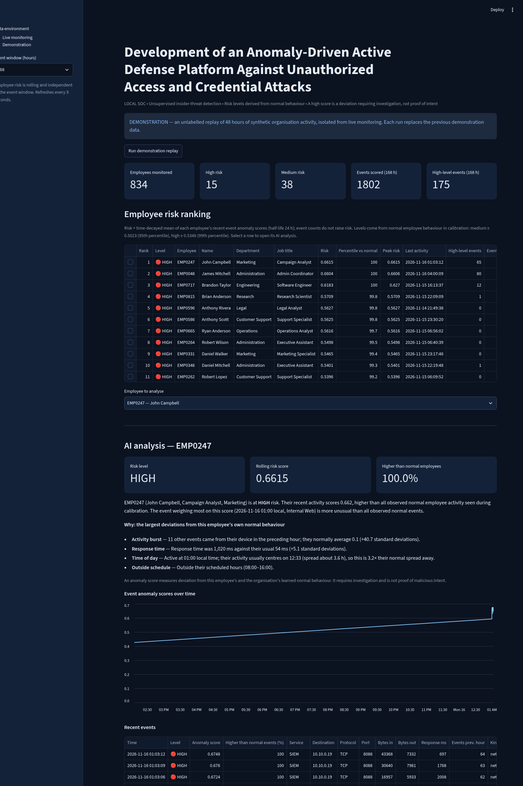

# Phase 2.5 report: Kali environment fixed and pinned

Status: **complete, awaiting approval before Phase 3.**

## 1. The problem

The model trained in the earlier environment did not load on Kali:

| Error | Cause |
| --- | --- |
| `No module named 'sklearn'` | `requirements.txt` used version ranges, and the Kali venv was not built from it. |
| `NotImplementedError: StringDtype ... NDArrayBacked.__setstate__` | The model was pickled with pandas 3, and Kali has pandas 2.3.3. The per-employee baselines (`PersonalBaseline`) were pandas DataFrames/Series inside the pickle, and pandas 3 string columns cannot be unpickled by pandas 2. |

## 2. Changes

**Version-independent model artifact**
* `PersonalBaseline` now keeps its fitted state as numpy arrays and plain Python containers only:
  * `employees_` and `services_` are lists;
  * `continuous_` and `hour_` are dicts of arrays;
  * `service_prob_` is a 2-D array and `service_unseen_prob_` is an array.
  * pandas is still used during fitting and for the output frame, but never stored.
* Categorical model inputs are cast to plain `object` strings before they reach the scikit-learn encoder, so pandas 3 `StringDtype` cannot leak into the fitted pipeline either.
* Lookups are explicit methods: `stat`, `hour`, `service_probability`, `unseen_service_probability`. `explain.py` uses them instead of pandas indexing.
* `runtime.pandas_references(obj)` scans the pickle stream for any `pandas.*` reference:
  * `train.py` refuses to save a model that has one (exit 3, "PORTABILITY ALERT");
  * two tests check this, on a freshly fitted brain and on the committed artifact.
* The loader turns unpickling errors into a clear message: install `requirements.txt` or retrain.
* Equivalence check: the old pandas implementation and the new one give **identical** personal features (max abs difference 0.0, same missing-value pattern). The check covered unknown employees and unseen services.

**Pinned environment**
* `requirements.txt` is the `pip freeze` of the Kali venv (Python 3.14.10):
  * the direct dependencies are listed first, explicitly: `streamlit`, `pandas==2.3.3`, `numpy==2.5.5`, `scikit-learn==1.9.1`, `joblib==1.6.0`, `scipy`, `openpyxl`;
  * after them, every transitive dependency is pinned.
* `openpyxl` was also missing from the Kali venv, and retraining needs it.
* `requirements-dev.txt` adds pytest, so the runtime file stays minimal.

**Retrained on Kali**
* `python -m monitor.brain.train` uses the unchanged Phase 1 protocol:
  * fit on `Normal_Behavior_Learning` only (earliest 70% by time);
  * `destination_port` is excluded;
  * per-employee deviation features use baselines from the training window only;
  * level boundaries are quantiles of the next 15% of normal events (5% / 1% FPR budgets);
  * evaluation uses held-out normals plus attacks.
* The new `models/ai_engine/insider_brain.joblib` replaces the old one (version `insider_brain:070ff5017cb2`).
* `metrics.json` now records `model_config.trained_with`: python 3.14.10, numpy 2.5.5, pandas 2.3.3, scikit-learn 1.9.1, joblib 1.6.0. It also records `artifact_contains_pandas_objects: false`.

## 3. Metrics: unchanged

Every number in the re-frozen `metrics.json` was compared with the previous one. **No metric changed, not even in the
last decimal place.** Only `generated_at_utc` and the two new provenance fields differ. The model is deterministic
(`random_state=42`), and the new baseline code is numerically identical. `directory.json`,
`employee_risk_heldout_window.csv` and `samples/behavioral_demo.jsonl` were regenerated byte-identical.

| | AUROC | AUPRC | Recall @ 1% FPR | Realized FPR |
| --- | --- | --- | --- | --- |
| Full model | 0.9983 | 0.9948 | 0.977 | 0.0114 |
| Artifact-free floor | 0.9736 | 0.8833 | 0.456 | 0.0124 |

| Other figures | Value |
| --- | --- |
| Event boundaries | medium 0.5327, high 0.5658 |
| Employee boundaries | medium 0.5023, high 0.5348 |
| Employee-day AUROC | 0.9986 (floor 0.9759) |
| Perfect-score alerts | none |

## 4. Verification on Kali

* **Clean clone.**
  * Steps: copied the tracked files into an empty directory (no `data/`, no `config.local.json`), ran `python3 -m venv .venv`, then `pip install -r requirements.txt`.
  * `pip check`: no broken requirements.
  * The resulting `pip freeze` is **identical** to `requirements.txt`.
  * With `requirements-dev.txt` added: `pytest` **62 passed**.
* **Working tree.** `pytest`: **62 passed**. This includes the 5 tests that could not run in the previous container (4 root-guarded, 1 systemd user manager).
* **Dashboard.**
  * Started with `./start.sh`, switched to *Demonstration*, ran the replay, then captured the page with headless Chromium.
  * The page had 0 exceptions, and the server log had no errors.
  * The page shows 834 employees ranked (15 HIGH, 38 MEDIUM) and the AI analysis of the top employee with the reasons for the score.

