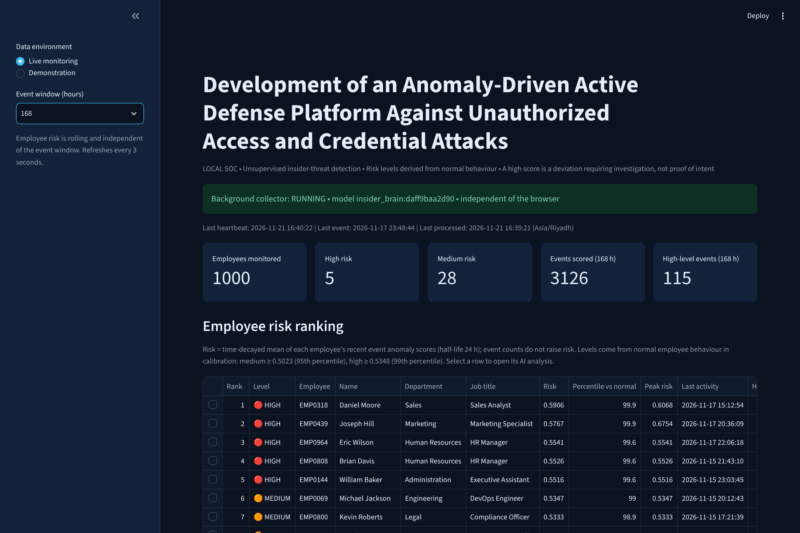
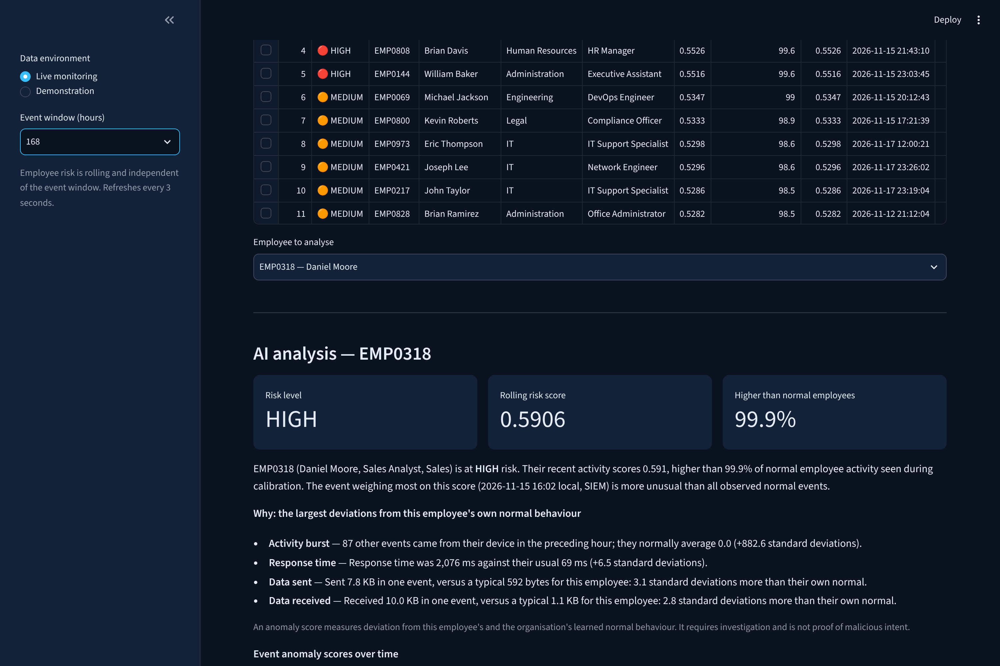

# Phase 2 report: brain wired into the collector; employee-first dashboard

Status: **complete, awaiting approval before Phase 3.**

## 1. Home page: employees ranked by risk

The screenshot shows the **live path**: the unlabelled held-out window of the dataset (9,515 events, 4–17 Nov 2026)
was replayed as raw JSONL through the real background collector (`monitor.worker`) into `live.db`, then the dashboard
was opened in *Live monitoring*. The collector banner shows the model version. In this window, 5 employees are at
HIGH risk and 28 at MEDIUM, out of 1,000.

* Ranking = current rolling risk: a time-decayed mean of the employee's event anomaly scores (half-life 24 h).
* The event count is shown for context only and is not an input. Duplicating every event leaves risk and ranking unchanged (tested).
* Levels: medium ≥ 0.5023 (P95) and high ≥ 0.5348 (P99) of normal employee risk during calibration. Both numbers are printed on the page and come from data.

## 2. Example explanation (EMP0318)

> EMP0318 (Daniel Moore, Sales Analyst, Sales) is at **HIGH** risk. Their recent activity scores 0.591, higher than
> 99.9% of normal employee activity seen during calibration. The event weighing most on this score (2026-11-15 16:02
> local, SIEM) is more unusual than all observed normal events.
>
> **Why: the largest deviations from this employee's own normal behaviour**
> - **Activity burst** — 87 other events came from their device in the preceding hour; they normally average 0.0 (+882.6 standard deviations).
> - **Response time** — Response time was 2,076 ms against their usual 69 ms (+6.5 standard deviations).
> - **Data sent** — Sent 7.8 KB in one event, versus a typical 592 bytes for this employee: 3.1 standard deviations more than their own normal.
> - **Data received** — Received 10.0 KB in one event, versus a typical 1.1 KB for this employee: 2.8 standard deviations more than their own normal.

How the explanation is built:

* **Which event.** The event shown is the one that lifts the decayed mean most above typical normal activity, `weight × (score − median normal score)`. Routine recent events therefore do not mask the burst that actually drives the risk.
* **Which reasons.** They come from that employee's own baseline (mean and spread of bytes, response time, activity, usual hour, service mix), ranked by how far each value is from normal.
* **The +882 sd figure.** It illustrates the sparse-baseline artifact reported in Phase 1: normal employees almost never have another event within an hour.

The panel also shows the employee's event scores over time and their recent events, each with its level and its
percentile against normal events.

## 3. Rule removal status

The brain became the detector and the rules were removed **in the same change** to `Engine.process`, so there is no
commit in which the system runs without a detector.

| Removed | Status |
| --- | --- |
| `monitor/core.py` rule engine: `CATEGORIES`, `ACTIONS`, `SQL`/`PRIV` regexes, `ssh/port/dos_count/window` thresholds, beaconing heuristic, alert cooldowns, severity mapping | **Deleted.** `Engine.ingest` now stores, derives features, scores and updates employee risk. |
| Threshold keys in configuration | **Deleted** from the examples; discarded on load from old `config.local.json` files (`RETIRED_RULE_KEYS`). |
| SSH brute force / port scan / DoS lab: `ssh_lab.py`, `lab_test.py`, `privilege_probe.py`, isolated OpenSSH, ports 9100–9119 | **Deleted.** `--prepare-lab` removes their managed sources from an existing configuration. |
| Rule-era views: `views.coverage()` category table, readiness "categories", `dataset_analysis.py` | **Deleted** or rewritten as component health. |
| "Rule-based" and attack-category wording in UI, fixtures, demo, README, testing guide and docs | **Deleted**; three rule-validation records were removed (they remain in Git history). |
| Tests asserting rule alerts (`test_ssh_penalties.py`, category assertions) | **Replaced** with tests of scoring, attribution, count-free risk and the explanation panel. A guard test fails if a rule engine reappears. |

What was kept:
* SQLite with additive migration (old rows and old alert tables preserved, no longer written);
* the history and the durable cursors;
* the 2 s collection and 3 s dashboard refresh;
* the single-writer lock and the capacity limits;
* the systemd units, the Journal adapter and the loopback Internal Web target;
* the watched file, and a new **telemetry inbox** (`runtime/lab/telemetry.jsonl`) for Phase 3.

## Tests

`pytest`: 55 passed. The remaining 5 cannot run in this development container: 4 refuse to run as root by design,
and 1 needs a systemd user manager. The 4 root-guarded tests pass when the UID check is patched to a normal user;
the systemd parser test was not run here and should be run on Kali as the normal user. New tests cover:

* the live path (inbox → collector → score → employee → dashboard);
* the feature conventions and the previous-hour counting;
* count invariance and data-derived levels;
* unattributed events;
* retired rule keys and sources;
* the demo ranking and the explanation panel.

## Notes for Phase 3

* Scripts must use a real device IP from `Device_Profiles` (in `models/ai_engine/directory.json`) and write the behavioural JSONL schema to the telemetry inbox.
* The stealth requirement (volume and ports close to normal) is exactly what the artifact-free floor measures: on the current model, about 45% detection at 1% FPR is the realistic expectation for low-volume scenarios.
