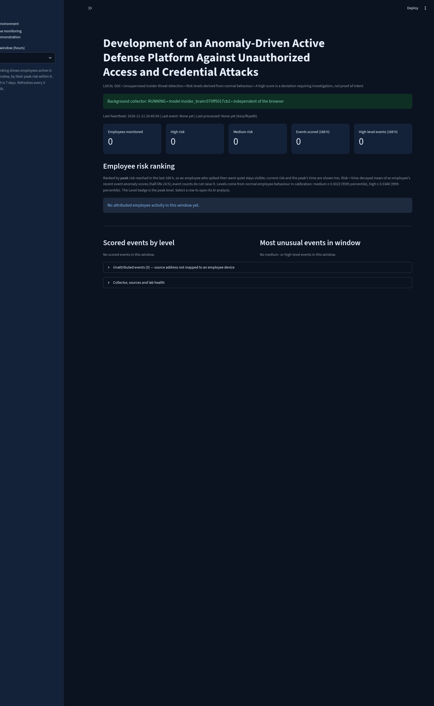
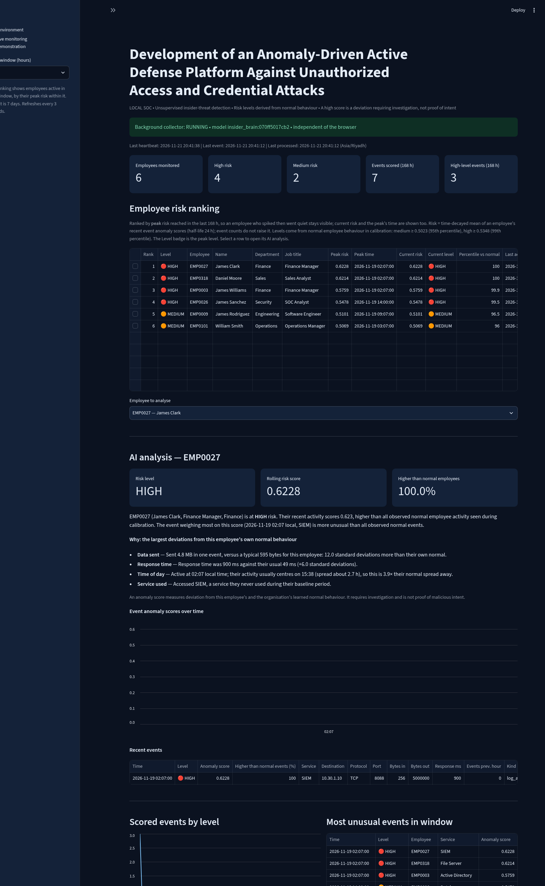

# Phase 3: insider-attack demonstration (loopback lab)

Status: **complete, awaiting approval before Phase 4 (automatic response).**

Six insider-attack scripts, one per dataset category. Each impersonates a real employee
(its own device IP from `Device_Profiles`), accesses one of the eight real services, and
writes behavioural telemetry to the lab inbox (`runtime/lab/telemetry.jsonl`) in the exact
schema the live collector reads. The collector scores each event with the frozen brain and
the employee's live risk rises on the dashboard. Where a loopback target exists the script
also performs a **real** action (a genuine SQL injection against the lab catalog; a real
modification of the watched file).

The scripts carry no attack signatures and no thresholds — they only produce behaviour. The
brain alone decides the level. Everything is loopback-only and limited to impersonating
dataset employees; nothing touches real infrastructure.

## The six scripts

| Script (`python -m monitor.attacks.…`) | Category | Service | Signal the brain sees | Design intent |
| --- | --- | --- | --- | --- |
| `data_exfiltration` | Data exfiltration | File Server | `bytes_out` far above the employee's own normal | **HIGH** (loud) |
| `sql_injection` | SQL injection | Database | abnormal response time + payload on an unusual DB access | **HIGH** (loud) |
| `privilege_escalation` | Privilege escalation | Active Directory | a service outside the employee's baseline (service rarity) | **HIGH** (loud) |
| `sabotage_log_tampering` | Sabotage / log tampering | SIEM + watched file | rare SIEM access **and** a file-integrity change | **HIGH** (loud) |
| `data_snooping` | Out-of-role snooping | File Server | an out-of-role destination, at small volume | **MEDIUM** (stealthy) |
| `credential_misuse` | Credential misuse | Active Directory | activity at an hour outside the employee's usual time | **MEDIUM** (stealthy) |

The loud scenarios stack two independent deviations (e.g. volume **and** an unusual hour), which
is what carries a single event confidently to HIGH; the intended feature stays the top reason.
The stealthy scenarios lean on one small deviation from the employee's own habit, which is why
they sit at MEDIUM — that is the honest limit the Phase 1 "artifact-free floor" measures, and the
reason they are included.

> **Same result on any day.** Day of week is a model feature, so every scenario lands on a fixed
> mid-week workday (the most recent Wednesday, always within the last 7 days) instead of "the most
> recent workday". `credential_misuse` uses the hour opposite the employee's own baseline activity
> hour (their mean hour + 12 h; 00:07 for EMP0101) rather than a fixed 03:07, so it stays MEDIUM
> whatever day the demo is run. `tests/test_attacks.py` checks all six across two full weeks.

> **Expected vs. actual.** The printed expected level is the scenario's design intent for a
> well-chosen employee, not a guarantee: a value far from one employee's baseline may be ordinary
> for another. The brain is always the authority. Each script also prints a local *projection* of
> the level (`--no-score` to skip).

## Choosing an employee

Pick someone for whom the target is genuinely out of character — that is what the brain keys on.
Any `EMPxxxx` from `Device_Profiles` works; the scripts resolve the device IP automatically.

- **Service-rarity scenarios** (`privilege_escalation`, `data_snooping`, `sql_injection`,
  `sabotage_log_tampering`) are strongest against an employee who never uses the target service.
  To list the services an employee never used in the training baseline:

  ```bash
  .venv/bin/python -c "
  import numpy as np; from monitor.brain.runtime import load_brain
  b=load_brain().baseline_; i=b.index_['EMP0003']
  print([b.services_[j] for j in range(len(b.services_))
         if np.isclose(b.service_prob_[i,j], b.service_unseen_prob_[i])])"
  ```

- **Volume / timing scenarios** (`data_exfiltration`, `credential_misuse`) work against anyone.

The demonstration below uses six different employees so each lands in its own row.

## Running the demo

One-time lab setup (if not already done), then start the collector and the dashboard:

```bash
.venv/bin/python -m monitor.install --prepare-lab     # creates the inbox and watched file
# Start the background collector and (optionally) the loopback lab target:
.venv/bin/python -m monitor.worker &                  # or the installed systemd user units
.venv/bin/python -m monitor.lab &                     # loopback Internal Web + SQLi catalog
./start.sh                                             # dashboard at http://127.0.0.1:8501
```

Open the dashboard in **Live monitoring** (the default), window **7 days** (the default). Then fire
the attacks — each is one command:

```bash
.venv/bin/python -m monitor.attacks.data_exfiltration     --employee EMP0318
.venv/bin/python -m monitor.attacks.sql_injection         --employee EMP0026
.venv/bin/python -m monitor.attacks.privilege_escalation  --employee EMP0003
.venv/bin/python -m monitor.attacks.data_snooping         --employee EMP0009
.venv/bin/python -m monitor.attacks.credential_misuse     --employee EMP0101
.venv/bin/python -m monitor.attacks.sabotage_log_tampering --employee EMP0027
```

Useful flags (all scripts): `--dry-run` (build and print, write nothing), `--no-action`
(skip the real loopback action), `--no-score` (skip the local projection), `--count` / `--interval`
(emit more than one event — note a cluster within an hour triggers the dataset's burst artifact and
inflates the score, so single events are the default). Scenario-specific: `--service`, `--hour`,
`--megabytes`.

## What to watch on the dashboard

Within one or two collector polls (≈2 s each):

1. **Employee risk ranking** — the impersonated employees climb the table, ordered by their **peak**
   risk in the window. The Level badge is the peak level, so an employee who spikes then goes quiet
   stays at the top (current risk and peak time are shown alongside).
2. **AI analysis** — selecting a row explains the risk in plain language: the largest deviations
   from that employee's *own* normal behaviour, naming the feature behind each scenario (data sent,
   response time, service used, time of day).
3. **Most unusual events in window** — the individual high/medium events.
4. **Unattributed events** — the `sabotage_log_tampering` watched-file change appears here (a file
   change has no source IP, so it is a system-level signal, not tied to the employee).

## Result of the demonstration

The six scripts were run on Kali against a fresh live database. The collector attributed and scored
all six events (plus the one file-integrity change) and the ranking came out exactly as designed:

| Rank | Employee | Scenario | Peak risk | Level | Top reason the brain gave |
| --- | --- | --- | --- | --- | --- |
| 1 | EMP0027 (James Clark, Finance) | Sabotage / log tampering | 0.623 | 🔴 HIGH | Sent 4.8 MB to the **SIEM**, a service never used before, at 02:07 |
| 2 | EMP0318 (Daniel Moore, Sales) | Data exfiltration | 0.621 | 🔴 HIGH | Sent a bulk transfer, +13 sd above their own normal `bytes_out` |
| 3 | EMP0003 (James Williams, Finance) | Privilege escalation | 0.576 | 🔴 HIGH | Accessed **Active Directory**, never used in their baseline |
| 4 | EMP0026 (James Sanchez, Security) | SQL injection | 0.548 | 🔴 HIGH | Database response time +11.7 sd above their own normal |
| 5 | EMP0009 (James Rodriguez, Engineering) | Out-of-role snooping | 0.510 | 🟠 MEDIUM | Accessed the **File Server**, out of role, at small volume |
| 6 | EMP0101 (William Smith, Operations) | Credential misuse | 0.507 | 🟠 MEDIUM | Active at 03:07, far from their usual time of day |

The SQL-injection script also really sent `pencil' OR '1'='1` to the lab's disposable SQLite catalog
(two rows: `pencil`, `notebook`). The payload broke out of the string literal and the injected `OR`
clause was executed, but the lab appends `%'` after the input, so the query ran as
`... LIKE '%pencil' OR '1'='1%'`; `'1'='1%'` is false, so it returned **1 of 2 rows (`pencil`)** — the
same as a normal search, not a dump of the catalog. The script now prints exactly this. The sabotage script really appended a tamper line to the
watched file, which the collector flagged as an unauthorised content change.

### Before

Live monitoring with the collector running and no insider activity yet — 0 employees ranked.



### After

The same dashboard after the six scripts ran — 4 HIGH, 2 MEDIUM, with the AI analysis of the
top-ranked employee (the sabotage scenario) open.



## Safety and limits

- Everything is loopback-only. The scripts never exploit real infrastructure; they impersonate
  dataset employees and emit schema-valid telemetry.
- Event counts are capped (`MAX_EVENTS = 50`) and a single transfer is bounded, so a script cannot
  flood the collector.
- The lab's existing limits are respected (bounded log rotation, the watched-file integrity target,
  the single-writer lock).
- The brain's output is an anomaly score — a deviation from learned normal behaviour that warrants
  investigation, not proof of intent. The synthetic-data caveats from Phase 1 still hold.
