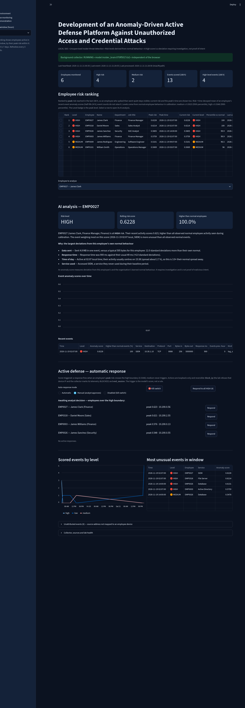
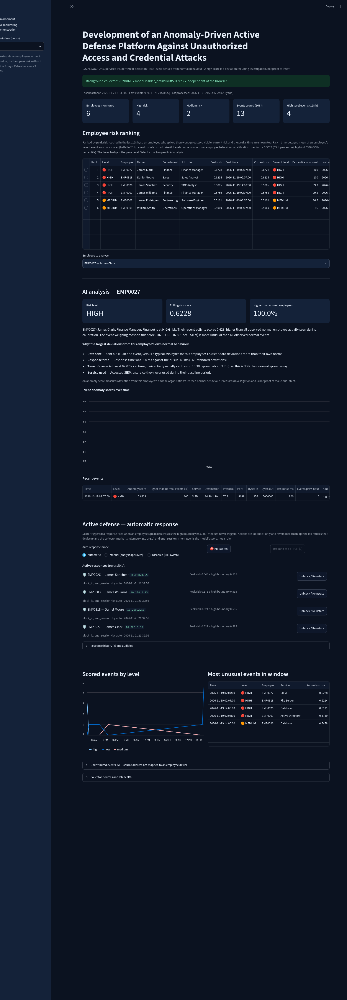
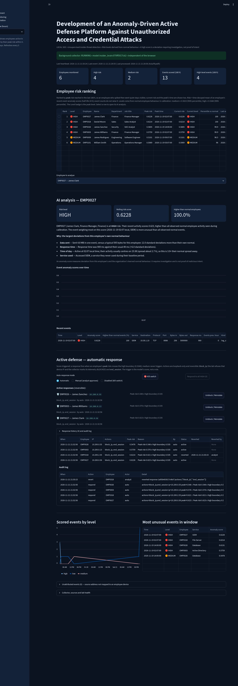

# Phase 4 report: automatic response (active defense)

Status: **complete, awaiting approval.**

Academic, defensive insider-threat project. Every action here is confined to the loopback
lab, reversible, and audited. No real host firewall, no real infrastructure, no real users
are touched.

## 1. The trigger is the score, not a rule

A response is proposed when an employee's **peak** rolling risk crosses the data-derived
**high** boundary (`brain.employee_boundaries_['high']`, ≈ 0.5348 — the 99th percentile of
normal employee risk during calibration). MEDIUM never triggers. There is no hand-written
threshold and no attack signature: the boundary is a quantile of normal behaviour, fixed at
training time, and the trigger reads the model's own output.

Three modes (`monitor/response.py`, stored in the engine `state` table):

| Mode | Behaviour |
| --- | --- |
| `automatic` | the collector applies the response as soon as an employee crosses high |
| `manual` | crossing employees are listed for the analyst, who approves each (or "Respond to all HIGH") |
| `disabled` | **kill-switch** — nothing new fires; existing responses remain until reverted |

A reverted response is **not** auto-re-triggered for the same peak: the analyst's decision
stands until that employee's peak rises *above* the peak already handled (a genuinely
escalating threat re-triggers; a dismissed one does not).

## 2. The actions — bounded and reversible

Both are loopback-only and written to `runtime/lab/enforcement.json` (atomic replace):

* **`block_ip`** — the employee's device IP is added to the enforcement blocklist.
  * The **loopback lab target honours it**: a request that declares a blocked source
    (`X-Lab-Source` header) is refused with HTTP 403. No host firewall is touched.
  * The **collector honours it**: any further telemetry from a blocked IP is stored with
    `status = BLOCKED` and `enforced = 1`, and does **not** raise the employee's risk — the
    attempt is recorded for audit but prevented.
* **`end_session`** — the employee's lab session is marked ended in the same file; the lab
  refuses them until reinstated.

Both are reversed from the dashboard (**Unblock / Reinstate**), which lifts only the
enforcement that no other active response still requires.

## 3. Dashboard, audit and kill-switch

A new **"Active defense — automatic response"** section (live monitoring only) shows:

* the **auto-response mode** selector (Automatic / Manual / Disabled) and a prominent
  **⛔ Kill-switch** button;
* in manual mode, the employees **awaiting a decision** with a per-employee **Respond** button
  and a **Respond to all HIGH** button;
* the **active responses**, each with the employee, device IP, actions, who applied it and
  when, the reason (the score crossing plus the strongest deviation behind it), and an
  **Unblock / Reinstate** button;
* a **response history and audit log** expander: every response and every manual action
  (apply, revert, mode change, kill-switch) with timestamp and actor.

Every write goes to the `responses` and `response_audit` tables (additive schema migration;
older databases upgrade in place).

## 4. Deferred fix: attributing the sabotage file-integrity change

Previously the watched-file integrity change was recorded unattributed. The sabotage script
now writes a small audit sidecar (`<watched file>.actor.json`, the lab's stand-in for
file-audit/auditd) naming the device that changed the file; the collector reads and consumes
it when it detects the change, so the integrity-change event is attributed to the executing
employee. Stale sidecars (older than 10 minutes) are ignored, and the source IP is validated
and attributed through the directory exactly like any other event.

## 5. Live demonstration (Kali)

With the collector and dashboard running and the four Phase-3 attackers already over the high
boundary (EMP0027, EMP0318, EMP0003, EMP0026):

1. **Manual mode** — the dashboard lists all four as *awaiting analyst decision*, with their
   peak risk and device IP, and no active response.

   

2. **Automatic mode enabled** — within one collector cycle the responder blocked all four
   device IPs and ended their sessions. Each active response shows its reason, e.g.
   *"Peak risk 0.623 ≥ high boundary 0.535"*.

   

3. **Enforcement proven both ways:**
   * the lab returned **403** to a request declaring a blocked IP (`10.200.0.55`) and **200**
     to a non-blocked one;
   * re-running the SQL-injection script as the now-blocked EMP0026 was **refused by the lab
     (403)**, and the collector stored its new telemetry as **BLOCKED / enforced=1** (score
     0.613) without raising risk.

4. **Manual revert** — reverting EMP0318 (the dashboard's *Unblock / Reinstate*) removed it
   from the active responses, lifted the block on `10.200.2.55`, and recorded a `revert` by
   `analyst` in the audit log. In automatic mode it was **not** re-triggered, because its peak
   had not risen above the peak already handled.

   

## 6. How to run it

```bash
.venv/bin/python -m monitor.worker &          # collector (applies responses in auto mode)
.venv/bin/python -m monitor.lab &             # loopback lab target (honours the blocklist)
./start.sh                                     # dashboard

# drive an attacker over the high boundary (Phase 3), then on the dashboard:
#   Active defense → set mode to Automatic (or approve in Manual)
#   watch the block + end_session appear, re-run the attack to see it BLOCKED,
#   then Unblock / Reinstate to reverse it.
```

The enforcing lab can run on an alternative port with `python -m monitor.lab --port 8089`
(set `lab.web_port` in `config.local.json` to match, so the SQL-injection script's loopback
request targets it).

## 7. Tests

`tests/test_response.py` (plus engine/collector coverage): the high-peak trigger (medium does
not), auto vs. manual vs. disabled, enforcement-file writes, the collector marking blocked
attempts, reversal lifting enforcement and auditing, a block that stays while another response
still needs it, revert-stickiness in auto mode, and the sidecar attribution (fresh, stale,
absent). Full suite: **82 passed**.

## 8. Limits

* Loopback only; reversible; audited. The block is a local list the lab and collector honour,
  never a host firewall.
* A response is a reaction to an anomaly score — a deviation from learned normal behaviour
  that warrants investigation — not a determination of intent. The synthetic-data caveats
  from Phase 1 still hold.
